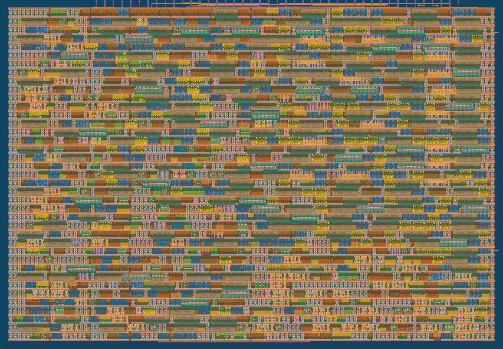

# 2 INT4 MACs per clock in one Tiny Tapeout tile



**[Try it in the browser: draw a digit and watch the chip's arithmetic classify it](https://joonsense.github.io/tt-int4-dot-accelerator/)**

> Newer: [tt-lowbit-dot-accelerator](https://github.com/Joonsense/tt-lowbit-dot-accelerator), 8 MAC per clock in the same tile with 1 bit activations. The demo has a 4 / 2 / 1 bit switch. · [3D layout viewer](https://gds-viewer.tinytapeout.com/?pdk=sky130A&model=https%3A%2F%2Fjoonsense.github.io%2Ftt-int4-dot-accelerator%2Ftinytapeout.oas)

A weight-stationary INT4 dot product accelerator for a single 1x1 [Tiny Tapeout](https://tinytapeout.com) tile
(161 x 111.5 um, SkyWater sky130). Load 16 weights once, then stream inputs at one byte per clock:
every byte carries two signed 4-bit values, so the chip does **2 multiply-accumulates per clock**.

It was specified, generated, formally checked, laid out and verified by an AI agent pipeline
([chip-lab](#how-it-was-made)), and hardened for free on GitHub Actions. **It has not been fabricated.**
Everything below is measured on the RTL, the post-layout gate-level netlist, or the sky130 layout reports.

## Numbers

| | |
|---|---|
| Throughput | 2.0 INT4 MAC per clock (16 MACs per 8-clock vector, back to back) |
| Area | 1x1 tile, 76.9% placement utilization |
| Timing | 50 MHz, setup slack +9.43 ns at the slow corner (ss, 100C, 1.60V), no hold violations |
| Signoff | DRC 0, LVS 0, antenna 0, Tiny Tapeout precheck passed |
| Gate-level tests | 6/6: protocol, host driver, 400 vectors with 20 weight reloads under random stalls and backpressure, chained dot products of 1 to 40 vectors, abort and reset recovery |
| FPGA | builds for the iCE40UP5K Tiny Tapeout simulator board: 445 of 5,280 logic cells, 23.7 MHz max ([bitstream](https://github.com/Joonsense/tt-int4-dot-accelerator/releases/tag/fpga-v1), not tried on a board) |
| Fault check | the same tests on a deliberately broken build: 6/6 fail |
| Power (estimate) | about 1.05 mW at 50 MHz, typical corner (LibreLane report) |

## Same tile, four designs

The design went through four versions. All fit one tile; each row was hardened and tested the same way.

| Version | MAC per clock | Clocks for 360 digit images (64 to 10 layer) |
|---|---|---|
| UART serial, INT8 ([repo](https://github.com/Joonsense/tt-uart-dot-accelerator)) | about 0.005 | |
| Parallel pins, INT8, chained ([repo](https://github.com/Joonsense/tt-pin-dot-accelerator)) | 0.5 | 482,400 |
| Parallel pins, INT4, chained | 1.0 | 252,000 |
| **Parallel pins, INT4, weight stationary (this repo)** | **2.0** | **115,760** |

The 4x step from the INT8 pin version came from two changes that each looked like 2x on paper.
Weight stationary alone did not pay off at INT8 (the 3-byte result output became the bottleneck,
0.57 MAC per clock for 17% more area). Packing two INT4 values per byte doubles the work per vector,
which hides the output and turns the same idea into a real 2x.

## A real workload: handwritten digits

`examples/digits` runs one fully connected layer (64 pixels to 10 classes, scikit-learn digits, INT4 quantized)
on the chip. The host loads each class's weights in chunks and streams all 360 test images through.

| | Accuracy |
|---|---|
| float | 95.83% |
| INT4, Python | 95.56% |
| **INT4, this chip (RTL)** | **95.56%**, all 3,600 dot products bit identical to Python, 115,760 clocks |

## Pins

| Pin | Direction | Function |
|---|---|---|
| `ui_in[7:0]` | in | data byte (two INT4 values, low nibble first) |
| `uio[0]` | in | IN_VALID |
| `uio[1]` | in | ABORT (discard partial vector, set ERR) |
| `uio[2]` | in | OUT_READY |
| `uio[3]` | in | CHAIN (carry the 32-bit sum into the next vector) |
| `uio[4]` | out | IN_READY |
| `uio[5]` | out | OUT_VALID |
| `uio[6]` | in | LOAD (byte is a weight byte) |
| `uio[7]` | out | ERR |
| `uo_out[7:0]` | out | result, 3 bytes, least significant first, 20-bit saturated |

Full protocol: [docs/info.md](docs/info.md).

## Host software

- `host/pin_client.py`: MicroPython driver for the Tiny Tapeout demo board (manual clocking). `load(w)`, `batch(xs)`,
  `batch_dot(w, xs)` for vectors of any length. The cocotb tests run this exact file against the RTL.
- `host/pio_stream.py`: the same API driven by two RP2040/RP2350 PIO state machines that generate the project clock
  and move one byte per clock. Co-simulated against the RTL with a PIO emulator running the same `@rp2.asm_pio` source
  (`test/pio_cosim.py`): about 9.3 system clocks per chip clock, so roughly 16 MHz chip clock and about 30 million
  INT4 MAC/s at a 150 MHz system clock. **Not yet tried on real hardware.**

## How it was made

chip-lab is a local design lab driven by an AI agent (Claude Code). For this chip it ran, end to end:

1. Parameterized RTL generation and a self-checking testbench (Icarus, Verilator lint)
2. Pre-layout area and slow-corner timing estimates (Yosys, OpenSTA) to reject bad candidates in seconds
3. Logic restructuring (Booth multipliers) with a formal equivalence proof per module (Yosys `equiv_induct`)
4. Local layout with LibreLane (about 75 seconds per candidate), then the official Tiny Tapeout GitHub Actions flow
5. Gate-level regression, stress tests, and a fault-injected build that must fail

Every number in this README came out of that pipeline. Mistakes it caught along the way included a missing pin
connection that let synthesis delete the weight registers (the area looked 4x too small) and a host driver bug that
timed out after 746 dot products.

## Run the tests

```
cd test
pip install -r requirements.txt
make                                  # RTL: protocol, host driver, stress
make COCOTB_TEST_MODULES=pio_cosim    # PIO host co-simulation
```

License: Apache 2.0. Built with the [Tiny Tapeout](https://tinytapeout.com) template and flow.
